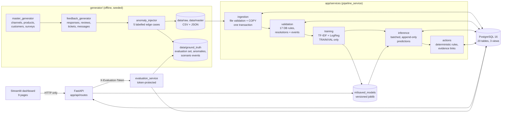

# Architecture

InsightPulse is a modular monolith. It has one Python codebase and one PostgreSQL 16 database, and
it exposes two entry points: a FastAPI service and a Streamlit dashboard. Everything runs on a laptop
without paid services, GPUs or internet access at runtime.

## Layers

| Layer | Location | Responsibility |
|---|---|---|
| Configuration | `app/core/config.py`, `.env` | Typed settings. Every threshold can be changed through environment variables. |
| Domain constants | `app/core/taxonomy.py`, `app/core/enums.py` | Theme taxonomy, sentiment labels and lifecycle state machines, each defined once. |
| Identifiers | `app/utils/id_generator.py` | Deterministic, zero-padded, immutable IDs and their validators. |
| Persistence | `database/schema.sql` (source of truth), `app/models/` (SQLAlchemy 2.x ORM mirror) | Normalised schema with keys, CHECK rules, indexes and history tables. A test keeps the ORM and the schema in sync. |
| Generation | `generator/` | Builds the seeded synthetic dataset and injects anomalies. Writes the manifest and checksums. |
| Services | `app/services/` | All business logic: ingestion, validation, training, sentiment, themes, trends, actions, analytics, feedback, evaluation and pipeline orchestration. |
| ML | `ml/common.py`, `ml/sentiment/`, `ml/themes/` | Feature extraction, leakage guards and the model classes. |
| API | `app/api/routes/`, `app/schemas/` | Request validation, pagination, filtering and error mapping. Routes are thin and delegate to services. |
| Dashboard | `dashboard/` | Presentation only. It calls the API over HTTP and contains no SQL or business rules. |
| Scripts | `scripts/` | Command-line entry points: setup, pipeline, validation, export, reproducibility and data dictionary. |

## Data flow and state

1. **Generation** writes CSV and JSON per table, plus `manifest.json` and `checksums.json`.
   Ground truth is written to a separate directory.
2. **Ingestion** (`ingestion_service.ingest`) runs file-level validation. Rejected rows go to
   `data/exceptions`, and when a parent is rejected its children are rejected too. All tables are then
   bulk-loaded with PostgreSQL `COPY` in **one transaction**. FeedbackItems are derived from the three
   source tables, and an `INGESTED` state event is written for every item.
3. **Validation** runs the database rules, upserts `data_quality_issues` (keyed by rule, entity and
   record), and applies resolutions as state transitions (`DUPLICATE`, `QUARANTINED`, `VALIDATED`;
   annotations become `ELIGIBLE` or `EXCLUDED`). Each transition writes a `state_change_events` row.
4. **Training** reads only `ELIGIBLE` annotations from the TRAIN and VALIDATION splits. Its only input
   feature is the text. Runtime guards reject label columns and TEST records. Hyperparameters and theme
   thresholds are chosen on VALIDATION. Models are saved with a version
   `major.minor+<data fingerprint>` and an `ACTIVE.json` pointer.
5. **Inference** scores every `VALIDATED` or `PROCESSED` item in keyset-paginated batches (default
   5,000) and *appends* rows to `sentiment_predictions` and `feedback_themes` under the run's `run_id`.
   Views expose the current state.
6. **Actions** evaluate the rules over the lookback window. New issues create actions with evidence
   links. Issues that are already active receive new evidence instead of a duplicate action.
7. **Evaluation** (only with the token) joins the stored predictions to the human-reviewed TEST labels
   and the anomaly registry. It writes `data/exports/<scale>/evaluation_report.json`.

Each run is recorded in `pipeline_runs` with its parameters, a per-step summary, timings, model
versions and any error. The API can start a run asynchronously (202 plus a status URL) or
synchronously (`wait=true`). A process lock prevents two runs at once (409).

## Key design decisions and trade-offs

| Decision | Why | Trade-off |
|---|---|---|
| SQL-first schema (`schema.sql`) with an ORM mirror | CHECK rules, partial unique indexes, views and identity columns are clearer in SQL, and reviewers can read one file | The schema exists twice. `tests/test_database.py` fails if the ORM drifts. |
| A single `feedback_items` table with exactly one source FK (enforced by a CHECK) | One unit of analysis for all three sources, while the DB guarantees the source type matches the source record | Agent replies stay in `support_messages` only, since they are not customer feedback. |
| Append-only predictions plus `v_current_*` views | History is never overwritten. Re-scoring, model rollback and auditing all work. | The table grows with every run. Archiving old runs would be the next step at scale. |
| Raw SQL (`text()`) in services for analytics | Aggregations with `FILTER`, `DISTINCT ON` and window functions are fast and readable | Less type safety than ORM queries. All parameters are bound, and the only SQL text built from strings is from fixed whitelists. |
| `COPY` ingestion and batched keyset inference | The full 120k-record dataset loads in seconds with bounded memory | Generated CSVs load all-or-nothing, which is intended. |
| TF-IDF (word 1–2-grams with stemming and negation marking, plus character 2–5-grams) and Logistic Regression | Fast, explainable, CPU-only. Character n-grams work for Hindi and Telugu scripts and romanised text without language-specific tokenisers. | Weaker than transformer models on unseen phrasing (see `docs/evaluation.md`). |
| A multilingual lexicon fallback with human-review flags | The baseline model is not assumed to understand Hindi or Telugu. Low-confidence non-English predictions are flagged and sent to a person. | The lexicon is small, so coverage is limited by design. |
| Deterministic rule-based actions | They can be explained to business owners, and every number in a description is traceable | Thresholds need tuning per business. All of them are configurable. |
| A token-protected evaluation module that is the only reader of ground truth | Ground truth cannot reach features or inference responses by accident. A static test enforces this. | A single shared token is MVP-grade access control. Production would use identity-based roles. |
| The dashboard only calls the API | No duplicated business logic. The dashboard can be replaced. | Each page makes HTTP calls. Responses are cached briefly in Streamlit. |

## Scalability on a 16 GB laptop

* The generator streams per-stream RNGs and writes each table once. The full dataset generates in
  about 12 seconds.
* Ingestion uses `COPY`. Validation rules are set-based SQL. Inference uses keyset pagination with a
  configurable batch size. Analytics aggregate in PostgreSQL and return only summaries.
* The API paginates every list endpoint (`page_size` ≤ 200 for feedback, ≤ 500 for issues).
* Full-scale timings and peak memory are reported in `docs/evaluation.md`.

## Security and privacy

* All data is synthetic: names come from curated lists, e-mails use `example.com`, phone numbers are
  fake, and no real data source is used.
* Secrets live only in `.env`, which is git-ignored. `.env.example` contains placeholders.
* Personal data found in text is quarantined, and the API and exports show only the redacted text.
* The evaluation token is compared in constant time. Ground truth is never exposed through inference
  endpoints, and `tests/test_api.py` checks this.
